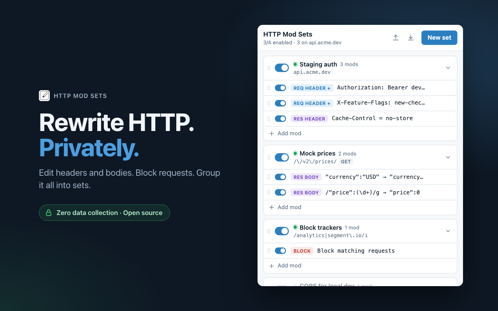

  

<h1 align="center">HTTP Mod Sets</h1>

  <strong>Rewrite HTTP. Privately.</strong> 
  Edit request and response headers, rewrite bodies, block requests. 
  Zero data collection. Open source.

  

## Features

- **Headers**: add or change request and response headers.
- **Bodies**: rewrite request and response bodies with plain text or regex, including `$1` and `$<name>` captures.
- **Blocking**: block any matching request.
- **Sets**: group mods by URL and method. Switch a whole set or a single mod on and off.
- **At a glance**: a green dot marks sets that match the current page, and the toolbar badge counts them.
- **Portable**: import and export your collection as JSON.

## Private by design

We collect nothing. No analytics, no accounts, no third parties, no servers.

Your rules are stored in `chrome.storage.local` and never leave your browser. Requests you edit go only where they were already going. See the [privacy policy](PRIVACY.md).

## Using it

| Do this | How |
|---|---|
| Open the popup | Toolbar icon or `Alt+Shift+M` (change it at `chrome://extensions/shortcuts`) |
| New set for this site | **New set** or `N`. The URL match is prefilled with the current host |
| Edit a set or a mod | Click its pencil icon, or click the mod. `Enter` saves, `Esc` cancels |
| Edit a set as raw JSON | **Edit as JSON** inside the set editor. `⌘/Ctrl+Enter` saves |
| Reorder | Drag the handle. Mods reorder within their set |
| Duplicate or delete | Row hover actions. Deletes and imports can be undone from the toast |
| Filter | Appears once you have 6 or more sets. Press `/` to focus it |

A URL match is a substring of the URL, or a regex written as `/pattern/flags`. Mods in a set run top to bottom.

## How it works

- Header mods and blocking use `declarativeNetRequest` rules, so they cover every request type, including navigations.
- Block rules take priority over header rules, so a blocked request is never modified instead.
- Body mods wrap the page's `fetch()`, and only apply to textual content types.
- At the network level, header values are set literally. Regex captures in a header's new value apply to page `fetch()` only.
- Chrome doesn't reliably let extensions rewrite the `Cookie` request header.

## Install from source

1. Clone this repository.
2. Open `chrome://extensions` and turn on **Developer mode**.
3. Click **Load unpacked** and pick the repository folder.

There is no build step.

## Contributing

See [CONTRIBUTING.md](CONTRIBUTING.md).

## License

[Unlicense](LICENSE). Public domain. See also the [terms of service](TERMS.md) and [privacy policy](PRIVACY.md).
